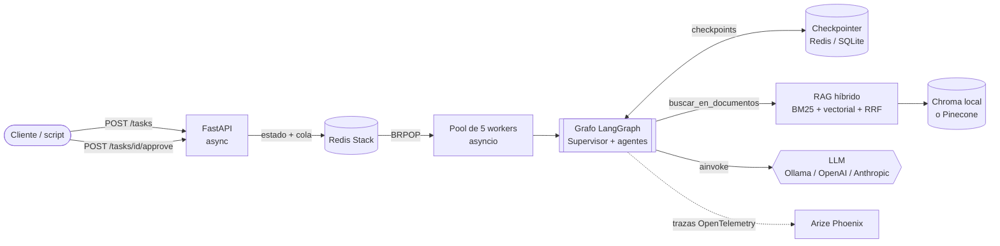
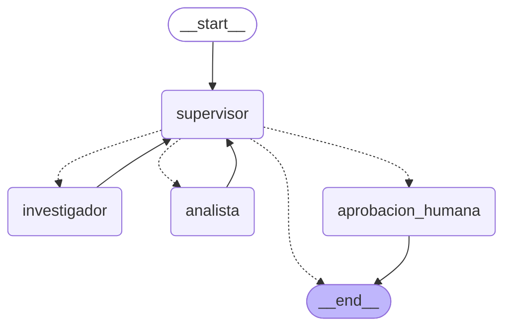

# Intelligence System

Sistema de IA de punta a punta: **RAG híbrido + orquestador multi-agente con Supervisor + API asíncrona + trazabilidad completa**. Se levanta con **un solo comando**.

> **Explicado en cinco minutos a un ingeniero senior:** una API FastAPI recibe una tarea en lenguaje natural, la encola en Redis y responde al instante con un `job_id`. Un pool de workers async toma la tarea y ejecuta un grafo de LangGraph: un **Supervisor** decide, paso a paso, a qué especialista delegar. El **investigador** busca información con dos herramientas —un **RAG híbrido** (BM25 + vectorial, fusionados con RRF) sobre la documentación técnica y una base de comentarios de usuarios—; el **analista** procesa los datos (sentimiento, estadísticas). Si la tarea pide una acción con efectos secundarios (publicar un reporte), el grafo se **pausa** y espera la **aprobación de una persona**. Todo el estado del grafo se guarda en un **checkpointer** (Redis o SQLite), así una ejecución pausada sobrevive a un reinicio del servidor. Cada ejecución queda trazada en **Arize Phoenix** (supervisor, agentes, llamadas al LLM, herramientas, tokens, costo y latencia). Todas las fronteras —API, herramientas, configuración— están validadas con **Pydantic**, y ninguna llamada bloquea el event loop.

---

## Arquitectura



### Grafo de agentes

Generado con `graph.get_graph().draw_mermaid()` a partir del grafo real (`app/graph.py`):



Las líneas punteadas son aristas **condicionales**: el Supervisor elige el destino. Si cierra (`FINISH`) y la tarea es crítica, pasa obligatoriamente por `aprobacion_humana` antes de terminar.

---

## Decisiones de arquitectura

| Decisión | Por qué |
|---|---|
| **Supervisor jerárquico** (no cadena lineal) | La tarea necesita decidir *quién* actúa *cuándo*. El Supervisor delega con instrucciones puntuales (el especialista no ve todo el historial: evita contaminación de contexto) y valida antes de cerrar. |
| **Ruteo dinámico** | El investigador siempre actúa primero; el analista solo si la solicitud pide análisis (sentimiento, promedio, cálculos). Una pregunta documental pura se resuelve con un solo especialista. |
| **Supervisor a prueba de LLMs chicos** | Con modelos locales (llama3.2) la salida estructurada a veces vuelve vacía. Hay reintentos y un **plan B por reglas**; la **rúbrica de validación está en código** (no se puede cerrar antes de tiempo ni saltear al investigador) y hay un tope de pasos contra el "Supervisor infinito". |
| **RAG híbrido con RRF** | La búsqueda vectorial entiende significado pero diluye términos exactos (`testcontainers`, `Vault`); BM25 hace lo contrario. Se fusionan por *posición* (Reciprocal Rank Fusion), porque sus puntajes viven en escalas distintas. Corren en paralelo (`asyncio.gather`). |
| **Embeddings multilingües locales** | El corpus y las preguntas están en español: `paraphrase-multilingual-MiniLM-L12-v2` (384 dim) vía fastembed, sin PyTorch ni API key. El mismo modelo indexa y consulta (un único `get_embedder()`). |
| **Chroma por defecto, Pinecone opcional** | `VECTOR_STORE=chroma` funciona sin cuentas ni claves (ideal para evaluar). `VECTOR_STORE=pinecone` usa el índice Serverless; mismo contrato, cero cambios de código. |
| **Async de punta a punta** | LLM (`ainvoke`), embeddings, Redis (`redis.asyncio`), grafo (`ainvoke`) y herramientas (`async def`). Los SDK síncronos (Chroma, Pinecone, fastembed) se ejecutan con `asyncio.to_thread`. Un test revisa el código fuente para que no se cuele `requests`, `time.sleep` ni `.invoke()` dentro de un `async def`. |
| **Cola en Redis + workers** | La API nunca ejecuta el grafo: encola (`LPUSH`) y responde `202`. Los workers hacen `BRPOP`. Si la API se reinicia, lo encolado sigue ahí. |
| **Checkpointer persistente** | `AsyncRedisSaver` (Redis Stack). Si Redis no trae los módulos RediSearch/RedisJSON, **no se cae**: avisa en el log y usa `AsyncSqliteSaver` (archivo en un volumen). Ambos sobreviven a reinicios. |
| **Human-in-the-loop** | Publicar un reporte tiene efectos secundarios. `interrupt()` pausa el grafo (estado guardado en el checkpointer) y `POST /tasks/{id}/approve` lo reanuda con la decisión. Qué es "crítico" lo decide una regla determinística y auditable, no el LLM. |
| **Pydantic en cada frontera** | Entradas/salidas de la API, `args_schema` y modelos de salida de **cada herramienta**, contratos del RAG y la **configuración** (`pydantic-settings`: un `CHECKPOINTER=postgres` falla al arrancar, no a mitad de una tarea). Todos los modelos usan `model_config = ConfigDict(...)`. |
| **Sin hard-coding** | Modelos, nombre del índice de Pinecone, rutas, URLs: todo en variables de entorno (`app/config.py` + `.env`). Un test lo verifica y otro busca API keys en el repo. |
| **El LLM redacta, el código calcula** | Probado con llama3.2: un modelo chico reescribe números al sintetizar. Las salidas de las herramientas se guardan como **evidencia** en el estado; el analista recibe los datos exactos; la síntesis recibe los fragmentos reales; y las cifras finales se recalculan con las mismas herramientas y se agregan como "Datos verificados". Como el modelo seguía escribiendo promedios propios aun con la instrucción de no hacerlo, un **guardrail de salida** quita del texto del LLM las líneas con cifras de rating y las secciones "Fuentes" inventadas: las instrucciones no alcanzan con un modelo de ~3B, el control está en el código. |
| **1 traza = 1 trabajo** | Se instrumenta solo LangChain/LangGraph (no los requests HTTP de FastAPI), para que los GET de polling no contaminen el p95 ni el costo por ejecución. Una tarea con aprobación humana genera **2 trazas** (la ejecución y la reanudación), agrupadas bajo la misma sesión (`session.id = job_id`). |

---

## Cómo ejecutarlo

### Requisitos
- **Docker Desktop** (incluye `docker compose`).
- **Ollama** en tu máquina, con el modelo descargado:
  ```
  ollama pull llama3.2
  ```
  (Alternativa sin instalar Ollama: `docker compose --profile ollama up --build` y `docker compose exec ollama ollama pull llama3.2`, con `OLLAMA_BASE_URL=http://ollama:11434` en el `.env`.)

### Levantar todo (una sola instrucción)

```
docker compose up --build
```

En Linux/macOS también: `./run.sh` (crea el `.env` si falta y levanta todo).

La primera vez tarda unos minutos (construye la imagen y descarga el modelo de embeddings **durante el build**; el arranque posterior ya no depende de internet). No hace falta crear el `.env` para el modo por defecto (Ollama + Chroma + embeddings locales, todo gratis).

| Servicio | URL |
|---|---|
| API + documentación interactiva (Swagger) | http://localhost:8000/docs |
| Arize Phoenix (trazas) | http://localhost:6006 |

Al arrancar, la API **indexa los documentos sola** si la base vectorial está vacía (es idempotente: no reindexa ni duplica). Para forzarlo: `docker compose exec api python -m scripts.ingest --forzar`.

### Variantes (en el `.env`, copiando `.env.example`)
- **OpenAI / Anthropic:** `GENERATION_PROVIDER=openai` + `OPENAI_API_KEY=...` (o `anthropic`).
- **Pinecone:** `VECTOR_STORE=pinecone` + `PINECONE_API_KEY=...` (el índice se crea solo, con la dimensión correcta).
- El `.env` está en `.gitignore`: nunca se sube.

---

### Problemas frecuentes

| Síntoma | Qué hacer |
|---|---|
| `Cannot connect to the Docker daemon` | Abrí Docker Desktop y esperá a que diga "Engine running". |
| Las tareas terminan en `FAILED` con un error de conexión a Ollama | Verificá que Ollama esté abierto y que hayas hecho `ollama pull llama3.2`. En Windows, si el contenedor no lo alcanza, definí la variable de entorno `OLLAMA_HOST=0.0.0.0` y reiniciá Ollama. |
| El log dice `No se pudo usar AsyncRedisSaver ... Se usa SQLite` | Redis no tiene los módulos de Stack (¿otro Redis ocupando el puerto 6379?). El sistema sigue funcionando y persistiendo con SQLite; con el compose de este repo se usa Redis Stack. |
| `port is already allocated` (6379, 8000 o 6006) | Otro programa usa ese puerto: cerralo o cambiá el puerto de la izquierda en `docker-compose.yml`. |

---

## API

| Método | Ruta | Qué hace |
|---|---|---|
| `POST` | `/tasks` | Encola la tarea. Responde `202` con `job_id` al instante. |
| `GET` | `/tasks/{job_id}` | Estado (`PENDING → RUNNING → WAITING_APPROVAL → DONE / FAILED`) y resultado: respuesta, **fuentes citadas**, contribuciones, traza de la delegación. |
| `POST` | `/tasks/{job_id}/approve` | Decisión humana sobre una tarea pausada. `409` si no espera aprobación. |
| `GET` | `/tasks/{job_id}/checkpoint` | Lo que el checkpointer tiene guardado de esa ejecución. |
| `POST` | `/rag/search` | Consulta directa al RAG híbrido, sin agentes. |
| `GET` | `/health` | Redis, checkpointer activo, base vectorial y proveedor de LLM. |

Ejemplo (lo más cómodo es la UI de http://localhost:8000/docs):

```
curl -X POST http://localhost:8000/tasks -H "Content-Type: application/json" ^
  -d "{\"query\": \"Según la documentación, ¿qué cobertura mínima de tests se exige?\"}"
```

---

## Pruebas del sistema y trazabilidad

Con el sistema levantado (en otra terminal, con Python y `httpx` instalados: `pip install httpx`):

```
python scripts/run_pruebas.py          # 6 pruebas de punta a punta -> resultados/pruebas.md
python scripts/setup_phoenix_pricing.py  # 1 vez: precio de referencia del modelo local (ver abajo)
python scripts/load_test.py            # 5 peticiones concurrentes -> resultados/load_test.json
python scripts/phoenix_metrics.py      # costo por ejecución y latencia p50/p95 desde Phoenix
```

Las 6 pruebas (`scripts/run_pruebas.py`):

| # | Prueba | Qué demuestra |
|---|---|---|
| 1 | Pregunta documental | RAG: respuesta con la fuente (`03_testing.md`); solo interviene el investigador. |
| 2 | Pregunta **trampa** (no está en los docs) | El sistema admite que no tiene la información en lugar de inventarla. |
| 3 | Feedback de usuarios + análisis | Delegación investigador → analista con herramientas. |
| 4 | Cruce documentación + feedback | RAG + base de comentarios + análisis en una misma tarea. |
| 5 | Tarea crítica **aprobada** | Pausa HITL → aprobación humana → publicación. |
| 6 | Tarea crítica **rechazada** | Pausa HITL → rechazo humano → no se publica. |

En Phoenix (http://localhost:6006, proyecto `intelligence-system`) cada ejecución tiene su árbol de spans: `job.ejecucion → LangGraph → supervisor / investigador / analista → llamadas al LLM y herramientas (buscar_en_documentos, buscar_comentarios, analizar_sentimiento, calcular_estadisticas)`, con tokens, costo y latencia.

**Sobre el costo con un modelo local:** Phoenix calcula `tokens × precio del modelo` y no trae precio para `llama3.2`, así que mostraría US$ 0. `setup_phoenix_pricing.py` registra un **precio de referencia** (US$ 0,06 / M tokens, aproximado de lo que cobra un proveedor por un modelo de ese tamaño). Es una referencia para estimar cuánto costaría la misma carga en la nube: el costo real de correr Ollama en tu máquina es $0. Con OpenAI/Anthropic, Phoenix ya trae el precio real.

### Evidencia
- [`resultados/pruebas.md`](resultados/pruebas.md): las 6 pruebas de punta a punta con **llama3.2 real**, con la respuesta completa y la delegación de cada una.
- [`resultados/load_test.json`](resultados/load_test.json): 5 tareas concurrentes, todas `DONE`; la API respondió cada POST en 29 a 101 ms.
- [`screenshots/`](screenshots/): 8 capturas de Phoenix (lista de trazas con latencia, tokens y costo; árbol de spans con la búsqueda RAG; delegación investigador → analista con la rúbrica del Supervisor corrigiendo al LLM; pausa y reanudación HITL; métricas de latencia y costo). Ver [`screenshots/README.md`](screenshots/README.md).

### Persistencia: demostración
1. Creá una tarea crítica (`demo_hitl.py` o `/docs`) y esperá a `WAITING_APPROVAL`.
2. Reiniciá la API: `docker compose restart api`.
3. `GET /tasks/{job_id}/checkpoint` sigue mostrando el estado y `siguiente_nodo: ["aprobacion_humana"]`.
4. Aprobala: se reanuda desde donde quedó.

---

## Estructura del repositorio

```
app/
  main.py            API FastAPI (endpoints, lifespan)
  schemas.py         Contratos Pydantic de la API
  config.py          Configuración validada (pydantic-settings)
  graph.py           Grafo LangGraph (Supervisor + agentes + HITL)
  supervisor.py      Router: salida estructurada, plan B, rúbrica, ruteo dinámico
  state.py           Estado compartido del grafo
  hitl.py            Aprobación humana (interrupt) y tarea crítica
  checkpointing.py   Checkpointer: Redis Stack, con respaldo SQLite
  worker.py          Pool de workers async + estados del trabajo
  job_store.py       Estado de trabajos y cola en Redis (redis.asyncio)
  observability.py   Arize Phoenix / OpenInference
  llm.py             Fábrica de LLMs (Ollama / OpenAI / Anthropic)
  agents/            Investigador y analista + schemas de sus herramientas
  rag/               Embeddings, ingesta, bases vectoriales, retriever híbrido, servicio
data/documentos/     Corpus de ejemplo (4 documentos .md) y golden_set.json
scripts/             run_pruebas, load_test, phoenix_metrics, setup_phoenix_pricing, demo_hitl, ingest
tests/               160 tests
Dockerfile · docker-compose.yml · run.sh · requirements.txt · pyproject.toml · .env.example
```

---

## Tests

```
docker compose run --rm --no-deps api python -m pytest -q
```

(o `pytest -q` en un entorno con Python 3.12 y `pip install -r requirements.txt`). **No necesitan Redis, Phoenix, Ollama ni internet**: usan Redis simulado (`fakeredis`), un chat model guionado —que además simula el fallo real de llama3.2—, embeddings determinísticos y una base **ChromaDB real** en una carpeta temporal.

Cubren: ingesta idempotente y recuperación híbrida (golden set del módulo 4), fusión RRF, la validación Pydantic de cada herramienta y de la API (`422`), el Supervisor (plan B, rúbrica, tope de pasos), la capa de evidencia (las cifras verificadas ganan aunque el LLM diga otra cosa), el flujo HITL completo, **la persistencia tras un "reinicio"** (el grafo pausado se reabre desde el archivo y se reanuda), el respaldo a SQLite, y guardas de arquitectura (nada síncrono dentro de `async`, nada de claves ni modelos escritos en el código).

---

## Qué se verificó y qué no

**Verificado en una máquina real (Windows 11 + Docker Desktop + Ollama con llama3.2):**
- `docker compose up --build` levanta todo con una sola instrucción: build de la imagen, Redis Stack, Phoenix, ingesta automática del RAG y **`AsyncRedisSaver` sobre Redis Stack** activo.
- Las 6 pruebas de punta a punta con **llama3.2 real** terminaron en `DONE`, incluido el flujo HITL (aprobado y rechazado), con sus trazas en Phoenix. Reporte: `resultados/pruebas.md`.

**Lo que mostraron esas pruebas reales, y cómo se corrigió:** el flujo funcionó, pero el modelo chico **reescribía los números al sintetizar** (inventó un "rating 7/7 = 1" y un promedio de 3.2 para un tema cuyo promedio era 3.33) y en una tarea larga **perdió un dato** que sí estaba en la documentación (la estrategia *blue-green*). Causas: la ventana de contexto chica que Ollama trae por defecto, y que la síntesis trabajaba sobre resúmenes en prosa. Se agregó la **capa de evidencia** (`app/evidencia.py`): ventana de contexto de 8192 tokens, el analista recibe los datos exactos, la síntesis recibe los fragmentos reales de la documentación y **no escribe cifras** (las agrega el código como "Datos verificados"), la prosa del analista no llega a la síntesis cuando hay cifras verificadas, y un guardrail de salida quita del texto del LLM los promedios y las "Fuentes" que igual escribía (en la segunda corrida seguía poniendo 3.5 en vez de 3.2 pese a la instrucción). Con eso, en la segunda corrida la pregunta documental, la trampa y el cruce documentación + feedback (que antes perdía el *blue-green*) respondieron bien, y los promedios informados pasaron a ser siempre los correctos. También se corrigió "fuentes": un documento cuenta como fuente solo si lo encontraron **las dos búsquedas** (vectorial y léxica) o si el investigador lo citó; antes aparecían documentos sin relación cuando el agente consultaba la documentación en una tarea que no la necesitaba.

**Verificado en el entorno de desarrollo:**
- 160 tests en verde, con Python 3.12.3 sobre una instalación limpia de `requirements.txt` (y también en 3.13).
- La **supervivencia de una tarea pausada a un reinicio del servidor** (API, workers y Redis reales, por HTTP) y el respaldo a SQLite cuando Redis no trae los módulos de Stack.

**No verificado:** el backend de **Pinecone** contra la nube en este repo (la lógica es la del módulo 4, donde sí funcionó).

## Límites conocidos
- Los workers viven en el mismo proceso que la API (variante simple y habilitada por la consigna). Como la cola está en Redis, moverlos a un proceso aparte solo cambia quién consume esa misma cola.
- El corpus de ejemplo es chico (4 documentos): con `RAG_TOP_K=3` casi todo el corpus entra en cada búsqueda. La arquitectura está pensada para corpus mayores.
- La publicación del reporte es **simulada** (`publicar_reporte` en `app/hitl.py`); en un sistema real iría la llamada a Slack/mail con un cliente async.
- El análisis de sentimiento es una heurística por palabras clave, a propósito: es reproducible y testeable con asserts exactos.
